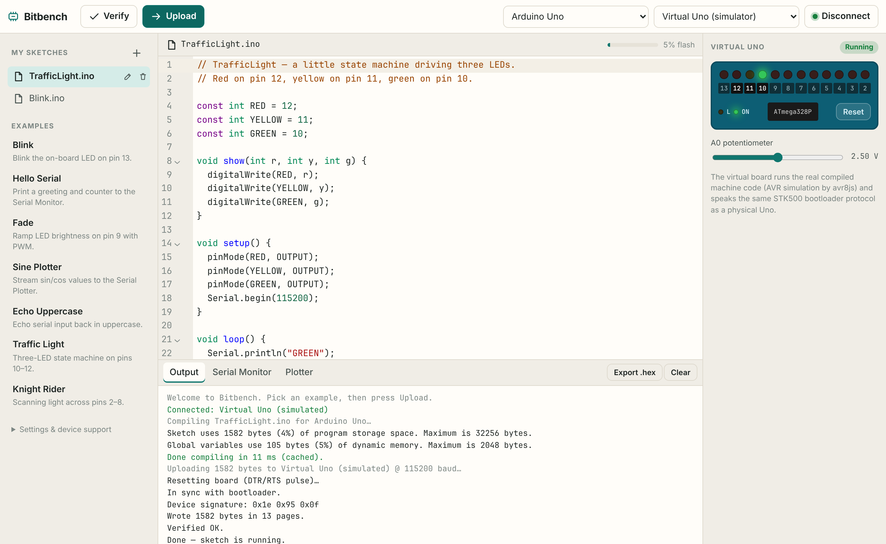
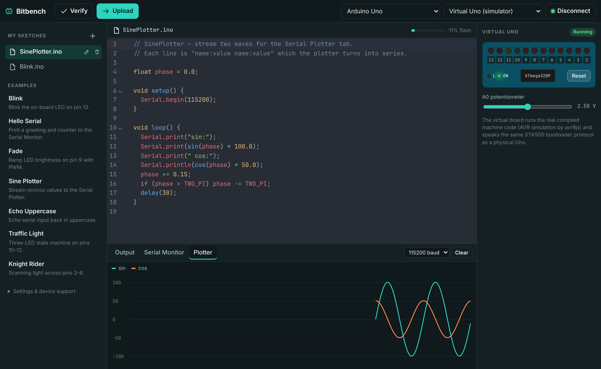
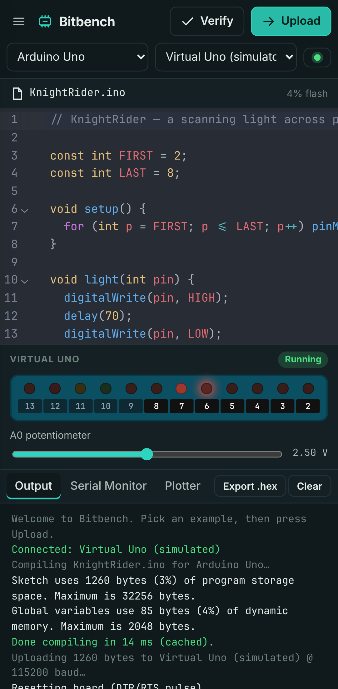

# Bitbench

**An Arduino IDE that runs in the browser and on Android phones.** Write a sketch, compile it, flash it over USB and talk to the board. Nothing to install on the desktop.



| Serial Plotter (dark) | Android phone |
|---|---|
|  |  |

## What works today

- **Editor:** CodeMirror 6 with C++ highlighting. Compiler errors appear inline on the right line. Ctrl+R verifies, Ctrl+U uploads.
- **Cloud compile:** a Rust (axum) server runs `avr-gcc` against a small Arduino-compatible core. It generates function prototypes like the Arduino IDE does, and returns Intel HEX, flash/RAM usage and structured diagnostics. Results are cached by content hash.
- **Flashing:** a TypeScript STK500v1 uploader (the protocol `avrdude -c arduino` uses). It handles DTR auto-reset, sync, signature check, page writes and read-back verification.
- **Three ways to connect:**
  - **Web Serial:** desktop Chrome and Edge, and ChromeOS.
  - **WebUSB with userland drivers:** Android Chrome. Drivers are included for **CDC-ACM** (genuine Uno and Mega), **CH340/CH341** (most clones), **CP210x** and **FTDI**.
  - **Virtual Uno:** a simulated board, described below.
- **Virtual Uno:** runs the compiled machine code on avr8js (the open-source AVR simulator behind Wokwi). It emulates the Optiboot bootloader byte for byte, so the real uploader code path is exercised. It shows the D2–D13 LEDs with PWM brightness, has an A0 potentiometer, a reset button, and garbled output when the baud rate is wrong, like a real board.
- **Serial Monitor and Plotter:** the plotter accepts the Arduino IDE 2 formats (`a:1 b:2`, `1,2,3`).
- **Local-first:** sketches are stored on the device. It's a PWA, so it works offline, and unmodified examples flash offline from a precompiled bundle.
- **Android app:** a Trusted Web Activity config in [`android/`](android/README.md). It runs in real Chrome, so WebUSB keeps working.
- **7 demo examples:** Blink, Hello Serial, Fade (PWM), Sine Plotter, Echo Uppercase (serial input), Traffic Light and Knight Rider.

## Repository layout

```
core/       MIT Arduino-compatible core for ATmega328P (Arduino.h, Serial, millis, PWM, ADC…)
server/     Rust compile server + static host  (axum, tokio)
web/        React 19 + TypeScript + Vite PWA
  src/lib/serial/    Transport interface, Web Serial, WebUSB drivers, Virtual Uno
  src/lib/upload/    STK500v1 uploader
  e2e/               Playwright tests (desktop + Pixel 7 emulation)
examples/   Demo sketches (+ index.json). Precompiled into web/public/examples.json
android/    Trusted Web Activity (Bubblewrap) config
```

## Run it locally

Requirements: Node 22+, pnpm, Rust 1.85+, and the AVR toolchain (`apt install gcc-avr avr-libc binutils-avr`, or `brew install avr-gcc` on macOS).

```bash
cd web && pnpm install && pnpm build
```

```bash
cd web && BITBENCH_STATIC_DIR=dist cargo run --release --manifest-path ../server/Cargo.toml
```

Then open http://localhost:8787. For live reload during development, run the server without `BITBENCH_STATIC_DIR`, plus `pnpm dev` in `web/`. Vite proxies `/api` to the server.

Docker (server, toolchain and app in one image):

```bash
docker build -t bitbench . && docker run -p 8787:8787 bitbench
```

## Tests

```bash
cd server && cargo test
```

```bash
cd web && pnpm test
```

```bash
cd web && pnpm e2e
```

- `cargo test`: 14 tests. Sketch preprocessing, diagnostics, path scrubbing, and real avr-gcc builds.
- `pnpm test`: 19 tests. Intel HEX, the CH340/CDC/FTDI drivers against a fake USB device, and STK500 upload to the virtual board with the firmware then running.
- `pnpm e2e`: 8 Playwright tests against the real server. Covers upload, serial I/O, plotter, inline errors, offline mode, persistence and the phone layout.

The e2e suite starts the Rust server itself. If Playwright can't find a browser, set `CHROMIUM_PATH`.

## Using real hardware

- **Desktop:** choose *USB serial port (Web Serial)*, press Upload and pick the board in Chrome's dialog.
- **Android:** connect the board with an OTG adapter. Choose *USB device (WebUSB driver)* and press Upload.

The USB drivers follow the Linux kernel and usb-serial-for-android protocols and are unit-tested against a fake device. **They have not yet been tested on physical hardware.** That's the first thing to do with a real Uno, a CH340 clone and a phone.

## Known limits / roadmap

- **Boards:** only ATmega328P (Uno and Nano) so far. Next are Mega (STK500v2), Leonardo (AVR109 with the 1200-baud touch), ESP32 (esptool-js) and RP2040 (PICOBOOT over WebUSB).
- **Libraries:** the core is a small subset of the Arduino API. There's no `String`, `Wire`, `SPI` or library manager yet. Using the official ArduinoCore-avr through `arduino-cli` on the server is the natural upgrade.
- **Security:** the server rejects path-traversal includes and strips server paths from logs. For a public deployment, also run each compile in a sandbox (container, nsjail or gVisor) with CPU and memory limits.
- **Offline compiling:** in-browser AVR compilation (avr-gcc built for WebAssembly) would make edited sketches work offline too.

MIT licensed. The bundled core is original code written for this project.
